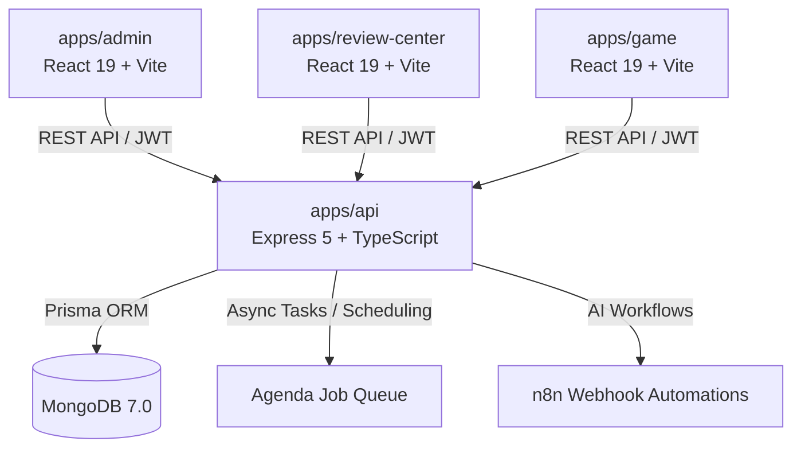

# BoardQuest: Gamified Board Exam Preparation & Analytics Platform

[](https://nodejs.org/)
[](https://pnpm.io/)
[](https://turbo.build/)
[](https://www.mongodb.com/)
[](https://www.prisma.io/)
[](#license)

> [!IMPORTANT]
> **Confidential & Proprietary Source Code**
> This repository contains proprietary source code and intellectual property of the **BoardQuest Capstone Development Team**. Unauthorized copying, distribution, or modification of this project via any medium is strictly prohibited.

---

## Table of Contents
- [Project Title](#boardquest-gamified-board-exam-preparation--analytics-platform)
- [Project Description & Purpose](#project-description--purpose)
  - [Target Audience & Stakeholders](#target-audience--stakeholders)
  - [Key Features](#key-features)
  - [Technology Stack](#technology-stack)
- [Setup Instructions](#setup-instructions)
  - [Prerequisites](#prerequisites)
  - [1. Clone Repository & Install Dependencies](#1-clone-repository--install-dependencies)
  - [2. Environment Configuration](#2-environment-configuration)
  - [3. Database Setup & Seeding](#3-database-setup--seeding)
  - [4. Running the Development Servers](#4-running-the-development-servers)
  - [5. Alternative: Running via Docker Compose](#5-alternative-running-via-docker-compose)
  - [6. Quality Assurance & Testing](#6-quality-assurance--testing)
- [File Structure Explanation](#file-structure-explanation)
  - [Monorepo Overview](#monorepo-overview)
  - [Application Architecture Breakdown](#application-architecture-breakdown)
- [Contact Information](#contact-information)
- [License](#license)

---

## Project Description & Purpose

**BoardQuest** is a comprehensive, gamified learning management and board exam preparation ecosystem designed to transform high-stakes licensure exam review (e.g., Medical Technology, Clinical Chemistry, and allied health sciences) into an engaging, data-driven, and adaptive journey.

Traditional board exam preparation often suffers from low student engagement, passive memorization, and lack of real-time analytical feedback. **BoardQuest** addresses these challenges by uniting gamified quest mechanics with rigorous academic assessment, institutional progress tracking, and AI-driven content refinement.

### Target Audience & Stakeholders

| Stakeholder Group | Role & Purpose in BoardQuest |
| :--- | :--- |
| **Students & Examinees** | Gamified practice environment featuring XP progression, streaks, achievements, customizable mock exams, timed challenges, and granular performance analytics by topic. |
| **Faculty & Subject Experts** | Authoring, categorizing, and validating question banks with Bloom's taxonomy mapping, difficulty weighting, and AI-powered question paraphrasing. |
| **Review Centers & Partner Schools** | Cohort management, student roster onboarding, institutional analytics, pass-rate forecasting, and comparative diagnostic reporting. |
| **System Administrators** | Multi-tenant governance, Role-Based Access Control (RBAC), user lifecycle management, audit trails, and global system health monitoring. |

### Key Features

- **🎮 Gamified Assessment Engine**: Quests, dynamic XP calculation, leveling milestones, daily streaks, and interactive quizzes.
- **📚 Question Bank & Workflow Management**: Multi-tiered review process (Draft -> Review -> Approved -> Published) with rich text support and Excel bulk import/export.
- **🤖 AI-Powered Automation**: Integrated with n8n workflow automations for question paraphrasing, explanation generation, and automated analytics summaries.
- **📊 Real-Time Analytics & Reporting**: Topic mastery heatmaps, time-spent diagnostics, strength/weakness indicators, and institutional scoreboards.
- **⚡ Bulletproof Modular Architecture**: Monorepo structure powered by Turborepo, React 19, Vite 8, Tailwind CSS v4, Express 5, and Prisma ORM with MongoDB.

### Technology Stack



#### Monorepo & Backend (`apps/api`)
- **Runtime & Language**: Node.js (v18+) with TypeScript
- **Web Framework**: Express.js (v5)
- **Database & ORM**: MongoDB with Prisma ORM
- **Authentication**: Stateless JWT with secure HTTP-only cookies & Argon2 password hashing
- **Job Queue & Scheduling**: Agenda.js (MongoDB-backed background workers)
- **Validation**: Zod schema validation
- **Testing**: Jest, ts-jest, and Supertest

#### Frontend Applications (`apps/admin`, `apps/review-center`, `apps/game`)
- **Framework & Tooling**: React 19, Vite 8, TypeScript
- **Styling & UI**: Tailwind CSS v4, `@aejkatappaja/phantom-ui`, Radix UI primitives, Lucide Icons, Sonner toasts
- **State Management & Data Fetching**: TanStack React Query v5 & Zustand
- **Routing**: React Router v7 with dynamic code-splitting (`React.lazy`)
- **Monorepo Build System**: Turborepo & pnpm Workspaces

---

## Setup Instructions

Follow these exact steps to set up and run the BoardQuest platform on your local development machine.

### Prerequisites

Ensure you have the following software installed:
- **Node.js**: `v18.0.0` or higher ([Download Node.js](https://nodejs.org/))
- **pnpm**: `v9.0.0` or higher (`npm install -g pnpm`)
- **MongoDB**: `v7.0` running locally on port `27017` or a MongoDB Atlas URI ([Download MongoDB](https://www.mongodb.com/try/download/community))
- **Git**: For version control ([Download Git](https://git-scm.com/))
- *(Optional)* **Docker & Docker Compose**: For containerized deployment

---

### 1. Clone Repository & Install Dependencies

```bash
# Clone the repository
git clone https://github.com/WhiteCat2023/boardquest-admin-2.git
cd boardquest-admin-2

# Install all monorepo dependencies using pnpm
pnpm install
```

---

### 2. Environment Configuration

Create the necessary `.env` files for each service from their provided examples:

#### Backend API (`apps/api/.env`)
```bash
cp apps/api/.env.example apps/api/.env
```
Ensure `apps/api/.env` contains valid values:
```env
PORT=5000
NODE_ENV=development
DATABASE_URL=mongodb://localhost:27017/boardquest
PRIVATE_KEY=your_super_secure_jwt_private_key_here
PUBLIC_KEY=your_super_secure_jwt_public_key_here
JWT_SECRET=your_super_secret_jwt_key_here
CLIENT_URL=http://localhost:5175
ADMIN_URL=http://localhost:5173
FRONTEND_URL=http://localhost:5173

# Optional Services
REDIS_URL=redis://localhost:6379
SMTP_HOST=smtp.gmail.com
SMTP_PORT=587
SMTP_USER=your_email@gmail.com
SMTP_PASS=your_gmail_app_password
CLOUDINARY_CLOUD_NAME=
CLOUDINARY_API_KEY=
CLOUDINARY_API_SECRET=
GEMINI_API_KEY=
N8N_BASE_URL=
N8N_WEBHOOK_PARAPHRASE=
N8N_WEBHOOK_ANALYTICS=
```

#### Admin Portal (`apps/admin/.env`)
```bash
cp apps/admin/.env.example apps/admin/.env
```
Ensure `apps/admin/.env` contains:
```env
VITE_API_URL=http://localhost:5000/api
```

#### Review Center Portal (`apps/review-center/.env`)
```bash
cp apps/review-center/.env.example apps/review-center/.env
```
Ensure `apps/review-center/.env` contains:
```env
VITE_API_URL=http://localhost:5000/api
```

---

### 3. Database Setup & Seeding

Generate the Prisma Client and seed the initial administrative user and question banks:

```bash
# Generate Prisma Client types and MongoDB engine bindings
pnpm --filter=./apps/api prisma generate

# Seed initial admin user and baseline data (Optional)
npx tsx apps/api/src/scripts.ts/setup_admin.ts
```

---

### 4. Running the Development Servers

You can start all services concurrently using Turborepo or run individual apps separately:

#### Option A: Start All Applications Concurrently (Recommended)
```bash
pnpm dev
```
This boots up the backend API along with all frontend applications:
- **Backend API**: [http://localhost:5000](http://localhost:5000)
- **Admin Portal**: [http://localhost:5173](http://localhost:5173) (or next available port)
- **Review Center Portal**: [http://localhost:5174](http://localhost:5174)
- **Game Application**: [http://localhost:5175](http://localhost:5175)

#### Option B: Run Specific Services Individually
```bash
# Run only the Backend API
pnpm dev:api

# Run only the Admin Frontend
pnpm dev:admin

# Run only the Review Center Frontend
pnpm dev:review-center

# Run only the Game Frontend
pnpm dev:game
```

---

### 5. Alternative: Running via Docker Compose

To spin up the full multi-container stack (MongoDB + API + Admin + Review Center) in isolated Docker containers:

```bash
# Build and start all services
docker compose up --build

# Stop all running containers
docker compose down
```

Services exposed via Docker:
- **MongoDB**: `localhost:27017`
- **Backend API**: `http://localhost:5000`
- **Admin Portal**: `http://localhost:8080`
- **Review Center Portal**: `http://localhost:8081`

---

### 6. Quality Assurance & Testing

```bash
# Run automated test suites across all workspaces
pnpm test

# Run backend integration & unit tests
pnpm test:api

# Run typecheck across all TypeScript projects
pnpm typecheck

# Run linting across the monorepo
pnpm lint

# Build production bundles
pnpm build
```

---

## File Structure Explanation

The repository is organized as a high-performance **Turborepo Monorepo** leveraging `pnpm workspaces`. Below is an explanation of the core files and folders:

### Monorepo Overview

| File / Folder Path | Description |
| :--- | :--- |
| [`apps/`](file:///d:/Code/capstone/apps) | Contains all standalone applications (API backend and client frontends). |
| [`docker-compose.yml`](file:///d:/Code/capstone/docker-compose.yml) | Multi-container orchestration config for MongoDB, API, and frontend web servers. |
| [`pnpm-workspace.yaml`](file:///d:/Code/capstone/pnpm-workspace.yaml) | Defines the workspace package boundaries and build script execution policies. |
| [`turbo.json`](file:///d:/Code/capstone/turbo.json) | Turborepo pipeline configuration for caching builds, tests, and linting. |
| [`package.json`](file:///d:/Code/capstone/package.json) | Root package manifest containing monorepo lifecycle scripts and Turbo dependencies. |
| [`lazy_loading_documentation.md`](file:///d:/Code/capstone/lazy_loading_documentation.md) | Architectural specification for dynamic code-splitting and page loading optimization. |

---

### Application Architecture Breakdown

```
capstone/
├── apps/
│   ├── admin/               # Administrative Management Portal (React 19 + Vite)
│   │   ├── src/
│   │   │   ├── app/         # Application router, providers, and layout wrappers
│   │   │   ├── components/  # Shared global UI components (Radix/Tailwind)
│   │   │   ├── config/      # Global client configurations & credentials
│   │   │   ├── features/    # Feature-based modular architecture (Bulletproof React)
│   │   │   │   ├── analytics/       # Student & institutional analytics dashboard
│   │   │   │   ├── auth/            # Authentication & session management
│   │   │   │   ├── faculty/         # Faculty roster & account administration
│   │   │   │   ├── question-bank/   # Question authoring, review, & bulk import
│   │   │   │   ├── review-center/   # Partner center management & onboarding
│   │   │   │   └── settings/        # System and profile preference settings
│   │   │   ├── hooks/       # Reusable React custom hooks
│   │   │   ├── lib/         # Axios client, React Query config, utility wrappers
│   │   │   └── stores/      # Zustand global state stores
│   │   ├── package.json
│   │   └── vite.config.ts
│   │
│   ├── api/                 # Core Backend REST API & Microservices (Express 5)
│   │   ├── prisma/          # Prisma schema definition for MongoDB database
│   │   ├── src/
│   │   │   ├── config/      # Environment, database, and JWT credentials
│   │   │   ├── controller/  # Express request handlers
│   │   │   ├── middleware/  # Auth guards, role checks (RBAC), error handling, rate limiting
│   │   │   ├── routes/      # REST API route definitions
│   │   │   ├── services/    # Business logic layer (Faculty, Questions, Review Center, etc.)
│   │   │   ├── seeds/       # Database population & initial seeding scripts
│   │   │   └── __tests__/   # Unit and integration test suites (Jest/Supertest)
│   │   ├── package.json
│   │   └── Dockerfile
│   │
│   ├── game/                # Gamified Student Learner Client (React 19 + Vite)
│   │   ├── src/             # Gamified quiz engine, leveling UI, interactive study quests
│   │   ├── package.json
│   │   └── vite.config.ts
│   │
│   └── review-center/       # Partner Review Center & Institutional Portal
│       ├── src/             # Cohort analytics, batch student enrollment, reports
│       ├── package.json
│       └── Dockerfile
```

---

## Contact Information

For inquiries, technical support, or project contributions, please reach out to the **BoardQuest Capstone Development Team**:

- **Project Client**: `Louie Dela Cerna Remotigue`
- **Project Coordinator**: `Desiree Cendana-Perreras`
- **Technical Consultant**: `Wilchin Dipolog`

- **Admin & Core Backend Repository**: [https://github.com/WhiteCat2023/boardquest-admin-2](https://github.com/WhiteCat2023/boardquest-admin-2)
- **Game & Learner Client Repository**: [https://github.com/Itsan12345/BoardQuesters](https://github.com/Itsan12345/BoardQuesters.git)
- **Issue Tracker**: [https://github.com/WhiteCat2023/boardquest-admin-2/issues](https://github.com/WhiteCat2023/boardquest-admin-2/issues)
- **Capstone Team Lead / Primary Maintainer**:
  - **Lead Developer/Maintainer**: `Berndt Dennis F. Canaya (WhiteCat2023)`
  - **Designer**: `Lance Keith Fajardo`
  - **UI/UX Designer**: `Arl Jacob Necesario`
  - **Full Stack Developer**: `Ethan Gabriel Rolloque`

---

## License

### Proprietary License

```
Copyright (c) 2026 BoardQuest. All rights reserved.

This software and its documentation are confidential and proprietary to BoardQuest.
Unauthorized copying, modification, distribution, sublicensing, or commercial use
of this software, in whole or in part, via any medium, is strictly prohibited without
explicit prior written authorization from the copyright holders.
```

---

*Developed with ❤️ by the BoardQuest Capstone Team (2026).*
