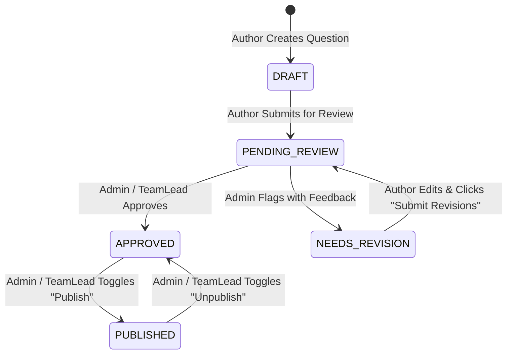
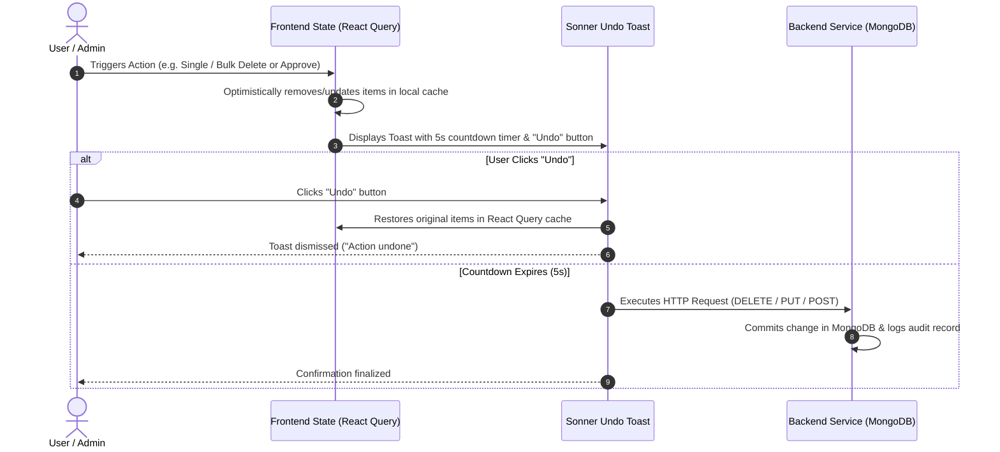

# Question Bank Logic & Implementation Plan

This document outlines the end-to-end architectural logic, lifecycle state transitions, database models, role-based permission rules, and UI component hierarchy for the **BoardQuest Question Bank System**.

---

## 1. Executive Summary & Core Objectives

The Question Bank serves as the centralized repository for managing academic exam items, evaluation benchmarks, and review questions across departments.

### Primary Workflows
1. **Multi-Source Item Creation**: Manual single-question entry (`AddQuestion.tsx`) and automated bulk ingestion (`AddedQuestionUsingCSV.tsx`).
2. **Multi-Stage Quality Review Pipeline**: Transitioning questions through `DRAFT` $\rightarrow$ `PENDING_REVIEW` $\rightarrow$ `APPROVED` / `NEEDS_REVISION` $\rightarrow$ `PUBLISHED`.
3. **Dedicated Revision Desk (`/revisions`)**: Author workspace for viewing administrator feedback comments, updating question content, and submitting revisions.
4. **Safety Mechanisms & Optimistic UI**: Reversible countdown Undo Toasts (5-second window) for single & bulk actions (Approval, Publishing, Deletion).

---

## 2. Database Schema & Data Models

### Prisma MongoDB Models (`schema.prisma`)

```prisma
model Question {
  id            String             @id @default(auto()) @map("_id") @db.ObjectId
  question      String             // Question prompt text
  type          QuestionType       // MCQ | TRUE_FALSE | SHORT_ANSWER
  choices       String[]           // Array of options for MCQ
  correctAnswer String             // Verified answer key
  difficulty    QuestionDifficulty // EASY | MEDIUM | HARD
  topic         String             // Topic benchmark reference
  feedback      String?            @default("") // Admin revision feedback notes
  schoolYear    String?            @default("S.Y. 2025-2026")
  status        QuestionStatus     @default(DRAFT) // DRAFT | PENDING_REVIEW | APPROVED | NEEDS_REVISION | REJECTED
  isPublished   Boolean            @default(false) // Live question flag

  category      Category           @relation(fields: [categoryId], references: [id])
  categoryId    String             @db.ObjectId

  author        AdminUser          @relation("QuestionAuthor", fields: [authorId], references: [id])
  authorId      String             @db.ObjectId

  createdAt     DateTime           @default(now())
  updatedAt     DateTime           @updatedAt
}

enum QuestionType {
  MCQ
  TRUE_FALSE
  SHORT_ANSWER
}

enum QuestionDifficulty {
  EASY
  MEDIUM
  HARD
}

enum QuestionStatus {
  DRAFT
  PENDING_REVIEW
  APPROVED
  NEEDS_REVISION
  REJECTED
}
```

---

## 3. Question Lifecycle State Machine



### State Definitions & Rules
| State | Visible Views | Allowed Actions |
| :--- | :--- | :--- |
| **`DRAFT`** | My Questions (`?view=my-questions`) | Author can Edit, Delete, Submit for Review |
| **`PENDING_REVIEW`** | Review Questions (`?view=review`) | Admins can Approve (`APPROVED`) or Request Revisions (`NEEDS_REVISION`) |
| **`NEEDS_REVISION`** | Revision Desk (`/revisions`) | Author views feedback notes, Edits item, and clicks **Submit Revisions** |
| **`APPROVED`** | Shared Library (`?view=bank`) | Admins/TeamLeads can Toggle Publish |
| **`PUBLISHED`** | Live Questions (`?view=published`) | Active in student exams; locked from direct edits until unpublished |

---

## 4. Role-Based Access Control (RBAC) Matrix

| Operation | SuperAdmin | Admin | TeamLead | Teacher |
| :--- | :---: | :---: | :---: | :---: |
| **Create Questions** | ✅ | ✅ | ✅ | ✅ |
| **Bulk Import (CSV)** | ✅ | ✅ | ✅ | ✅ |
| **View My Questions** | ✅ | ✅ | ✅ | ✅ (Own items only) |
| **View Review Questions** | ✅ | ✅ | ✅ | ❌ |
| **Bulk / Single Approve** | ✅ | ✅ | ✅ | ❌ |
| **Request Revisions (Feedback)** | ✅ | ✅ | ✅ | ❌ |
| **Submit Revisions** | ✅ | ✅ | ✅ | ✅ (Own items) |
| **Publish / Unpublish** | ✅ | ✅ | ✅ | ❌ |
| **Delete Questions** | ✅ | ✅ | ✅ (Non-published) | ✅ (Own non-published) |

---

## 5. View Routing & Navigation Architecture

| View Route / URL | View Parameter | Target Component | Purpose & Description |
| :--- | :--- | :--- | :--- |
| `/question-bank` | `?view=bank` | `QuestionBank.tsx` | **Shared Library**: All non-published approved evaluation questions. |
| `/question-bank` | `?view=my-questions` | `QuestionBank.tsx` | **My Questions**: Authored draft items filtered by `authorId`. |
| `/question-bank` | `?view=review` | `QuestionBank.tsx` | **Review Questions**: Subject cards grid filtering items in `PENDING_REVIEW`. |
| `/question-bank` | `?view=published` | `QuestionBank.tsx` | **Live Questions**: Published active questions (`isPublished: true`). |
| `/revisions` | N/A | `RevisionDesk.tsx` | **Revision Desk**: Dedicated two-pane workspace for revision feedback & resubmission. |
| `/question-bank/view/:id` | N/A | `ViewQuestion.tsx` | Question detailed inspection & action handler. |
| `/question-bank/create` | N/A | `AddQuestion.tsx` | Single question authoring form. |
| `/question-bank/edit/:id` | N/A | `AddQuestion.tsx` | Update existing question prompt & answer choices. |

---

## 6. Reversible Actions & Undo Toast Workflow

All high-impact actions (Approval, Publishing, Deletion) leverage **Optimistic UI Updates** paired with a 5-second countdown **Undo Toast** notification (`showUndoToast.ts`):



---

## 7. Verification & Testing Plan

### Automated & API Verification
- Execute API endpoints (`/questions/get`, `/questions/bulk/approve`, `/questions/bulk/status`, `/questions/publish/:id`).
- Ensure MongoDB ObjectId validation (`isValidObjectId`) handles non-standard environment IDs gracefully without throwing Prisma errors.

### Manual UX Verification
1. **Navigation**: Toggle between **My Questions**, **Review Questions**, **Live Questions**, **Shared Library**, and **Revision Desk**.
2. **Subject Ingestion**: Select subject cards in **Review Questions** and verify only `PENDING_REVIEW` items appear.
3. **Revision Flow**: Submit a question with `NEEDS_REVISION` status $\rightarrow$ View in `/revisions` $\rightarrow$ Click **Submit Revisions** $\rightarrow$ Verify status updates to `PENDING_REVIEW` with an Undo Toast option.
4. **Publish Lockdown**: Verify published questions cannot be edited or deleted until unpublished.
