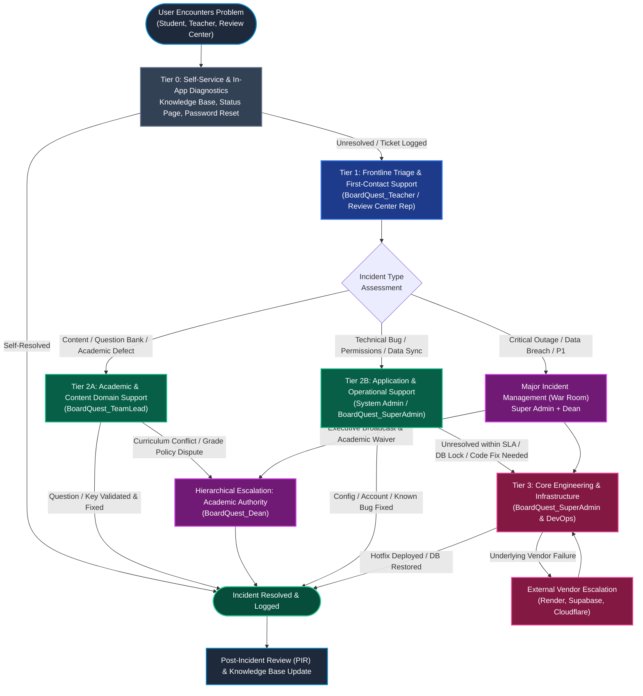
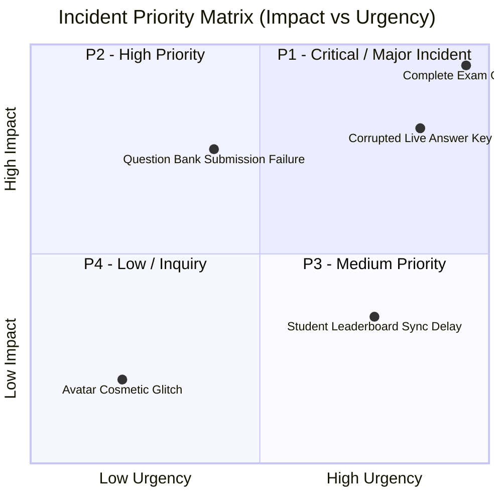
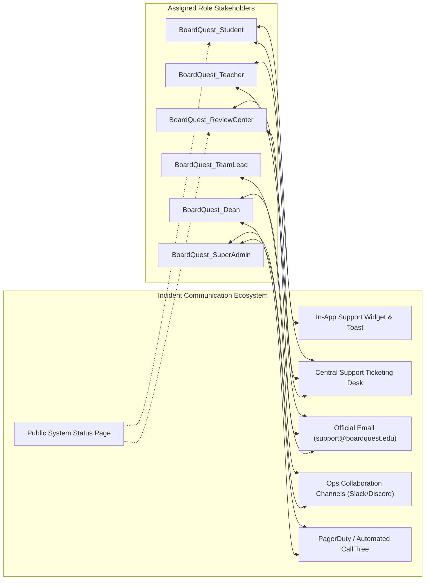
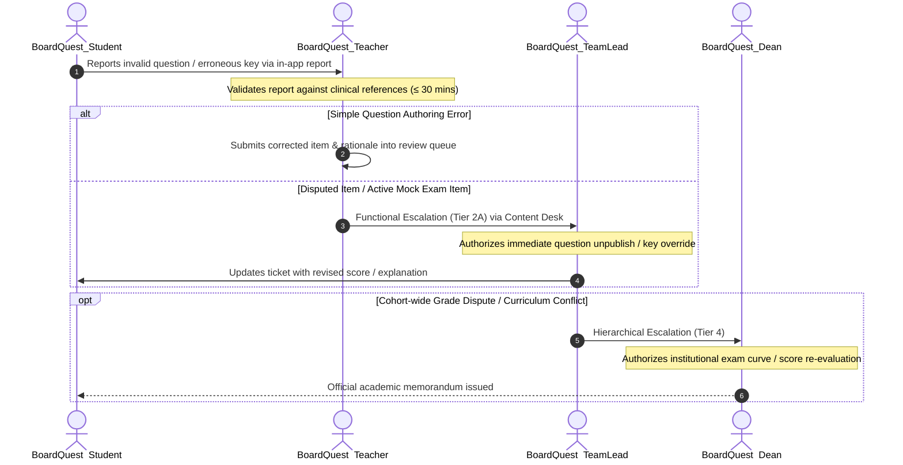
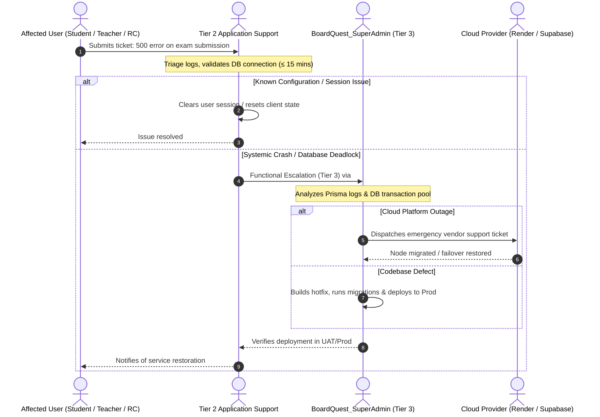
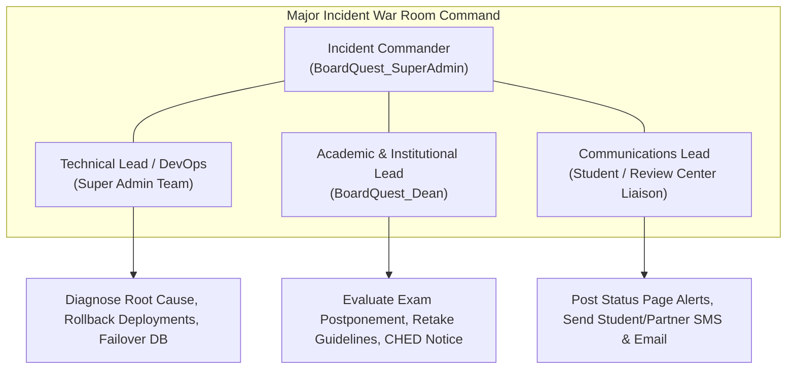
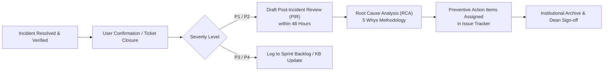

# BoardQuest: ITIL Incident Management & Escalation Path Documentation

This document defines the official **ITIL Service Operation: Incident Management & Escalation Path** framework for the **BoardQuest** platform. It establishes structured workflows, functional/hierarchical escalation paths, response/resolution target thresholds, and multi-channel communication protocols when users (Students, Faculty, Review Centers, or Administrators) encounter operational or technical problems.

This documentation directly references and aligns with the governance boundaries established in [roles_and_responsibilities.md](file:///d:/Code/capstone/roles_and_responsibilities.md).

---

## 1. Overview & Escalation Principles

In accordance with **ITIL v4 Service Management** principles, an *Incident* is defined as an unplanned interruption to a service or reduction in the quality of a service. The escalation framework distinguishes between two fundamental escalation dimensions:

1. **Functional Escalation (Horizontal):** Transferring an incident to a role or support group with specialized technical skills, content domain mastery, or system permissions (e.g., Tier 1 Faculty Support → Tier 2 Subject Team Lead → Tier 3 Super Admin / DevOps).
2. **Hierarchical Escalation (Vertical):** Elevating an incident up the administrative chain of command when an issue threatens service level agreements (SLAs), involves institutional liability, requires emergency resource reallocation, or warrants a Major Incident (P1) declaration (e.g., Team Lead → Dean / Academic Administrator & Super Admin).

---

## 2. End-to-End Incident Escalation Flowchart

The diagram below illustrates the complete lifecycle and escalation path from initial user problem encounter to final resolution and post-incident review (PIR).

---

## 3. Tiered Support Architecture & Role Alignment

Every support tier maps directly to the operational roles and accountability boundaries defined in Section 1 and Section 2 of [roles_and_responsibilities.md](file:///d:/Code/capstone/roles_and_responsibilities.md).

```mermaid
graph LR
    subgraph T0 [Tier 0: Self-Service]
        KB[Automated KB / FAQ / Status Page]
    end

    subgraph T1 [Tier 1: Frontline Triage]
        R1[BoardQuest_Teacher]
        R2[BoardQuest_ReviewCenter Coordinator]
    end

    subgraph T2 [Tier 2: Functional Specialists]
        R3[BoardQuest_TeamLead - Content Domain]
        R4[System Admin - Platform Support]
    end

    subgraph T3 [Tier 3: Deep Technical & Infrastructure]
        R5[BoardQuest_SuperAdmin - Tech Stack & DevOps]
        R6[External Cloud Providers]
    end

    subgraph T4 [Tier 4: Executive Governance]
        R7[BoardQuest_Dean - Academic Policy]
        R8[Incident Commander / Super Admin]
    end

    T0 --> T1
    T1 --> T2
    T2 --> T3
    T2 --> T4
    T3 --> T4
```

---

### Tier 0: Self-Service & Automated Remediation

| Parameter | Specification |
| :--- | :--- |
| **Primary Actor / Mechanism** | Automated In-App Systems, Self-Service Portal, Help Center Knowledge Base |
| **Target User Group** | `BoardQuest_Student`, `BoardQuest_Teacher`, `BoardQuest_ReviewCenter` |
| **Scope & Capabilities** | Automated password resets, session refresh, browser caching guidance, searchable question rationales, live system health check dashboard (`/healthz`). |
| **What Warrants Escalation to Tier 1** | Self-help fails to resolve the blocker; account locked out after automated retries; client-side rendering exception persistent across refresh; exam submission transaction errors. |
| **Target Response / Resolution Time** | Immediate (Automated / < 1 minute) |
| **Communication Channels** | In-App Help Tooltips, Public Status Page, Automated System Toast Notifications |

---

### Tier 1: Frontline Triage & First-Contact Support

| Parameter | Specification |
| :--- | :--- |
| **Role Alignment** | **`BoardQuest_Teacher`** (for Academic/Student inquiries) **`BoardQuest_ReviewCenter Representative`** (for Reviewee candidate roster/schedule inquiries) |
| **Scope & Capabilities** | First point of human contact. Validates report completeness (screenshots, question ID, exam batch ID); verifies student identity; solves navigational, syllabus clarity, and routine usage issues; classifies incident category and urgency. |
| **What Warrants Escalation to Tier 2** | <ul><li>**Academic / Question Defect:** Student flags a flawed answer key, disputed clinical rationale, or ambiguous distractor that requires subject-matter consensus.</li><li>**Application / Functional Glitch:** Student cannot submit quiz due to persistent API error, quest XP/streak is not crediting, or UI components fail to load.</li><li>**Access / Enrollment Failure:** Teacher or Review Center coordinator cannot enroll batches or assign guidance modules due to permission mismatches.</li><li>**First-Contact SLA Breach:** Issue remains unresolved after **15 minutes** (P1) or **2 hours** (P3).</li></ul> |
| **Expected Response Time** | <ul><li>**P1 / Urgent:** ≤ 15 minutes</li><li>**P2 / High:** ≤ 30 minutes</li><li>**P3 / Medium:** ≤ 2 hours</li><li>**P4 / Low:** ≤ 8 hours</li></ul> |
| **Expected Resolution Time** | <ul><li>**P1 / Urgent:** ≤ 1 hour (or immediate functional handoff)</li><li>**P2 / High:** ≤ 4 hours</li><li>**P3 / Medium:** ≤ 12 hours</li><li>**P4 / Low:** ≤ 24 hours</li></ul> |
| **Communication Channels** | <ul><li>**Primary:** In-App Feedback & Support Ticket Desk, Student Help Modal</li><li>**Secondary:** Official Institutional Email (`support@boardquest.edu`)</li><li>**Tracking:** Support Ticket Registry with auto-assigned Ticket ID</li></ul> |

---

### Tier 2: Functional, Content & Operational Escalation

Tier 2 splits functionally into two specialized domains based on the root cause determined at Tier 1:

#### Tier 2A: Academic Domain & Content Gatekeeping

| Parameter | Specification |
| :--- | :--- |
| **Role Alignment** | **`BoardQuest_TeamLead`** (Subject Team Lead / Department Head) |
| **Scope & Capabilities** | Content gatekeeper for specific medical technology verticals (Clinical Chemistry, Microbiology, Hematology, etc.). Has full authority to review, revise, unpublish, or replace defective question items in the live question bank without software deployments. |
| **What Warrants Escalation to Tier 2A** | <ul><li>Reported clinical inaccuracy or wrong answer key in published questions.</li><li>Item difficulty anomaly (e.g., 0% passing on a valid question).</li><li>Missing syllabus coverage or module content inaccuracies.</li></ul> |
| **What Warrants Escalation to Tier 4 (Dean)** | Departmental grade contestations, unresolvable curriculum disputes between instructors, or systemic failure to meet licensure exam syllabus benchmarks. |
| **Expected Response Time** | <ul><li>**P1 (Active Exam Item Defect):** ≤ 20 minutes</li><li>**P2 (High / Upcoming Mock Board):** ≤ 2 hours</li><li>**P3 / P4 (General Question Revision):** ≤ 8 hours</li></ul> |
| **Expected Resolution Time** | <ul><li>**P1:** ≤ 2 hours (immediate question quarantine/override)</li><li>**P2:** ≤ 8 hours</li><li>**P3 / P4:** ≤ 24–48 hours</li></ul> |
| **Communication Channels** | <ul><li>**Internal Ticketing:** Jira Service Desk / GitHub Project Board (Content Vertical)</li><li>**Collaboration:** Dedicated Team Lead Content Chat (Teams/Discord/Slack #content-review)</li><li>**Email:** Departmental faculty mailing lists</li></ul> |

#### Tier 2B: Application & Platform Administration

| Parameter | Specification |
| :--- | :--- |
| **Role Alignment** | **System Admin / Application Support Specialist** (Operating under delegation from `BoardQuest_SuperAdmin`) |
| **Scope & Capabilities** | User account role modifications, clearing persistent cached sessions, inspecting client error payloads, checking server logs via application logging dashboards, validating database record states via Admin portal tools. |
| **What Warrants Escalation to Tier 3** | <ul><li>Application returns 500 Internal Server Errors reproducible across multiple tenants.</li><li>Database connection pool exhaustion, latency spikes (>2000ms), or database write deadlocks.</li><li>Security alert triggered (unauthorized API access, suspicious token generation).</li><li>Software bug requiring schema migration, code refactoring, or new container build.</li><li>Tier 2 resolution timer exceeds **50% of SLA limit**.</li></ul> |
| **Expected Response Time** | <ul><li>**P1:** ≤ 15 minutes</li><li>**P2:** ≤ 45 minutes</li><li>**P3:** ≤ 2 hours</li><li>**P4:** ≤ 6 hours</li></ul> |
| **Expected Resolution Time** | <ul><li>**P1:** ≤ 2 hours (or immediate Tier 3 handoff)</li><li>**P2:** ≤ 6 hours</li><li>**P3:** ≤ 16 hours</li><li>**P4:** ≤ 36 hours</li></ul> |
| **Communication Channels** | <ul><li>**Ticketing:** Internal Engineering Ticketing System (Linear / Jira)</li><li>**Operations Chat:** `#admin-ops-support` channel</li><li>**Direct Notification:** In-app SuperAdmin Notification Bar</li></ul> |

---

### Tier 3: Core Engineering, Infrastructure & Root-Cause Resolution

| Parameter | Specification |
| :--- | :--- |
| **Role Alignment** | **`BoardQuest_SuperAdmin`** (Technical Owner & DevOps Lead) |
| **Scope & Capabilities** | Total authority over the entire technical stack: source code repository, CI/CD deployment pipelines (Turbo/GitHub Actions), Render hosting, Docker containers, Prisma ORM schema, PostgreSQL database instances, and environment secrets. |
| **What Warrants Escalation to Tier 3** | <ul><li>Production crash, server unresponsiveness, or network partition.</li><li>Data corruption, broken database migrations, or missing backups.</li><li>Critical regression introduced by a recent release.</li><li>External cloud infrastructure outages requiring failover or vendor support ticket creation (Render, Supabase, Cloudflare).</li></ul> |
| **Expected Response Time** | <ul><li>**P1 / Critical:** ≤ 15 minutes (24/7 on-call)</li><li>**P2 / High:** ≤ 30 minutes</li><li>**P3 / Medium:** ≤ 4 hours</li><li>**P4 / Low:** ≤ 12 hours</li></ul> |
| **Expected Resolution Time** | <ul><li>**P1 / Critical:** ≤ 4 hours (hotfix deploy, rollback, or failover)</li><li>**P2 / High:** ≤ 12 hours</li><li>**P3 / Medium:** ≤ 48 hours</li><li>**P4 / Low:** Planned in next sprint release</li></ul> |
| **Communication Channels** | <ul><li>**Emergency:** PagerDuty / Opsgenie automated on-call paging, direct emergency mobile call tree</li><li>**Incident Command:** Dedicated War Room (`#war-room-incident-prod`)</li><li>**Codebase:** GitHub PR review queue with emergency hotfix bypass protocols</li></ul> |

---

### Tier 4: Executive & Institutional Governance

| Parameter | Specification |
| :--- | :--- |
| **Role Alignment** | **`BoardQuest_Dean`** (Academic Administrator) & **`BoardQuest_SuperAdmin`** (Incident Commander) |
| **Scope & Capabilities** | Institutional policy authority, legal and academic regulatory compliance (CHED / PRC), emergency exam schedule postponement, cohort-wide score recalibration sign-off, public incident disclosures, and contractual escalations with external Review Centers. |
| **What Warrants Escalation to Tier 4** | <ul><li>**Major Incident (P1) Active:** Complete platform downtime lasting > 1 hour during scheduled institutional mock board exams.</li><li>**Academic Integrity Compromise:** Suspected leak of question bank items, unauthorized batch score alteration, or mass cheating exploit.</li><li>**Data Breach:** Exposure of student personal identification or review center proprietary records.</li><li>**Institutional Dispute:** Contractual conflict or formal grievance raised by external `BoardQuest_ReviewCenter` leadership.</li></ul> |
| **Expected Response Time** | <ul><li>**P1 / Emergency:** ≤ 30 minutes</li><li>**P2 / Institutional Concern:** ≤ 2 hours</li><li>**P3 / Standard Review:** ≤ 24 hours</li></ul> |
| **Expected Resolution Time** | Defined by Executive Incident Directive (Academic adjustments made within 24 hours of technical recovery). |
| **Communication Channels** | <ul><li>**Direct:** Executive Phone Call / SMS, High-Priority Encrypted Email</li><li>**Executive Briefing:** Formal Incident Status Memorandum & Emergency Board Meeting</li></ul> |

---

## 4. Incident Priority & SLA/OLA Resolution Matrix

The priority of an incident is calculated using a standard ITIL **Impact × Urgency** matrix. The targets below represent binding Operational Level Agreements (OLAs) between support tiers.

### Priority Determination Matrix

### Comprehensive SLA & Escalation Threshold Targets

| Priority Level | Classification Criteria | Responsible Roles (from #2) | Max T1 Initial Response | Max Escalation Trigger Time (T1 → T2) | Max Escalation Trigger Time (T2 → T3) | Target Service Resolution (SLA) | Status Update Cadence |
| :--- | :--- | :--- | :--- | :--- | :--- | :--- | :--- |
| **P1 — Critical (Blocker)** | Complete platform outage, database failure, or critical glitch preventing an entire cohort from completing a scheduled mock board exam. | `SuperAdmin` (Command) `Dean` (Informed) `ReviewCenter` (Affected) | **≤ 15 mins** | **≤ 15 mins** | **Immediate (≤ 15 mins)** | **≤ 4 Hours** | Every 30 minutes |
| **P2 — High (Degraded)** | Core feature unavailable without workaround (e.g., question bank submission queue blocked, automated grading service timing out, review center cannot export results). | `SuperAdmin` (Engineering) `TeamLead` (Content) `Dean` (Informed) | **≤ 30 mins** | **≤ 45 mins** | **≤ 2 Hours** | **≤ 8 Hours** | Every 2 hours |
| **P3 — Medium (Normal)** | System functional with workaround available (e.g., isolated question rationale typo, student streak count discrepancy, non-critical filter failure in admin tables). | `Teacher` (Triage) `TeamLead` (Review) `SuperAdmin` (Backlog) | **≤ 2 Hours** | **≤ 4 Hours** | **≤ 12 Hours** | **≤ 24 Hours** | Every 12 hours |
| **P4 — Low (Inquiry / Minor)** | Cosmetic UI issue, general how-to inquiry, minor enhancement suggestion, non-urgent profile avatar adjustment. | `Teacher` Help Desk Staff | **≤ 8 Hours** | **≤ 24 Hours** | N/A (Sprint Backlog) | **≤ 5 Business Days** | At status change |

---

## 5. Communication Channels by Tier & Role

To eliminate miscommunication and guarantee auditability, each tier operates across defined official communication channels mapped directly to the roles in [roles_and_responsibilities.md](file:///d:/Code/capstone/roles_and_responsibilities.md).

### Channel Matrix by Support Tier

| Tier | Primary Communication Channel | Secondary / Fallback Channel | Tooling & Integration | Associated Roles |
| :--- | :--- | :--- | :--- | :--- |
| **Tier 0** | In-App Help Modals & Banner Alerts | Public System Status Page (`status.boardquest.edu`) | Embedded Tooltips, UptimeRobot, Vercel/Render Status Webhooks | `BoardQuest_Student` |
| **Tier 1** | Support Ticketing Portal (`help.boardquest.edu`) | Official Email (`support@boardquest.edu`) | Linear Service Desk, Zendesk, or GitHub Issues (Triage Board) | `BoardQuest_Student` `BoardQuest_Teacher` `BoardQuest_ReviewCenter` |
| **Tier 2A** | Departmental Review Queue & Content Channel | Academic Email & Bi-weekly Content Sync | In-app Question Review Queue, `#content-review` Chat | `BoardQuest_Teacher` `BoardQuest_TeamLead` |
| **Tier 2B** | Admin Operations Channel (`#admin-ops-support`) | Direct Ticket Escalation Tag (`@sysadmin`) | Linear / Jira Service Desk, Slack / Discord Webhooks | `BoardQuest_TeamLead` `BoardQuest_SuperAdmin` |
| **Tier 3** | Engineering War Room (`#war-room-incident-prod`) | Automated On-Call Escalation (SMS / Pager) | PagerDuty, Opsgenie, GitHub PR Review Queue | `BoardQuest_SuperAdmin` External Cloud Vendors |
| **Tier 4** | High-Priority Executive Call Tree / SMS | Formal Academic Memorandum & Video Briefing | Encrypted Direct Line, Google Meet Incident Command | `BoardQuest_SuperAdmin` `BoardQuest_Dean` |

---

## 6. Functional Escalation Protocols

### 6.1 Academic & Curriculum Defect Escalation Flow

When a problem pertains to academic content, examination integrity, or question bank authoring:

1. **Step 1 (Submission):** Student flags question item using the in-exam "Report Issue" button, providing rationale and observed contradiction.
2. **Step 2 (Tier 1 Validation):** Assigned `BoardQuest_Teacher` verifies clinical rationale against reference textbooks within 30 minutes.
3. **Step 3 (Tier 2A Escalation):** If item is live or requires editorial override, it is escalated to `BoardQuest_TeamLead`. The Team Lead uses Question Bank Studio permissions to unpublish the defective item or apply an immediate scoring key correction.
4. **Step 4 (Tier 4 Escalation, if needed):** If the defect compromised a high-stakes mock board exam impacting graduation eligibility or batch rankings, the Team Lead escalates to `BoardQuest_Dean` for academic score adjustments or re-take authorization.

---

### 6.2 Technical & Infrastructure Defect Escalation Flow

When an incident involves software bugs, infrastructure outages, or database anomalies:

1. **Step 1 (Ingestion):** User report generates a high-severity ticket in the central service desk.
2. **Step 2 (Tier 2 Triage):** Application administrator assesses API health metrics, error status codes, and user permissions.
3. **Step 3 (Tier 3 Escalation):** If reproducible in server logs as an unhandled exception, deadlocked transaction, or infrastructure degradation, the ticket is assigned directly to `BoardQuest_SuperAdmin`.
4. **Step 4 (Hotfix & Deployment):** Super Admin coordinates code or database mitigation, commits hotfix branch, executes CI/CD validation, and deploys directly to Production pursuant to Section 1 approval authorities.

---

## 7. Hierarchical Escalation & Major Incident Management (MIM)

### 7.1 Major Incident (P1) Declaration Triggers
A Major Incident is immediately declared if any of the following triggers occur:
- Platform-wide downtime exceeding **10 consecutive minutes**.
- More than **15% of active concurrent examinees** unable to load questions or submit mock board exams.
- Database write failure or transaction rollback loop affecting candidate exam records.
- Confirmed security breach, compromised administrative credentials, or data exfiltration.

### 7.2 Major Incident Team Structure & Responsibilities

- **Incident Commander (`BoardQuest_SuperAdmin`):** Holds sole authority over technical remediation, infrastructure cutover, database recovery, and vendor escalation.
- **Academic Authority (`BoardQuest_Dean`):** Decides whether scheduled exams must be paused, extended, or rescheduled; issues formal institutional advisories to faculty and external review centers.
- **Communications Lead:** Maintains real-time updates on the public status page every 30 minutes until full operational recovery is declared.

---

## 8. Incident Resolution, Post-Incident Review (PIR) & Continual Improvement

An incident is not officially closed upon technical recovery. In compliance with ITIL Continual Service Improvement (CSI):

1. **Resolution Verification:** The resolving tier must verify recovery using automated health checks, test submissions, and explicit confirmation from the affected user.
2. **Post-Incident Review (PIR):** For all P1 and P2 incidents, `BoardQuest_SuperAdmin` must publish a formal PIR document within **48 hours**, covering:
   - Chronological timeline of events and detection triggers.
   - Root Cause Analysis (RCA) utilizing the *5 Whys* methodology.
   - Preventive actions, architectural enhancements, or automated alert thresholds added.
3. **Dean & Stakeholder Briefing:** `BoardQuest_Dean` reviews and signs off on the final PIR to ensure institutional and regulatory reporting obligations are fulfilled.
4. **Knowledge Base Enrichment:** Any newly discovered operational workaround or remediation procedure must be converted into a Tier 0/Tier 1 Knowledge Base article within **3 business days**.

---

## 9. Document Control & Cross-Reference

| Document Attribute | Details |
| :--- | :--- |
| **Document Title** | BoardQuest ITIL Artifact — Escalation Path Documentation |
| **Framework Version** | ITIL v4 Service Operation & Incident Management Standard |
| **Governing RACI Document** | [roles_and_responsibilities.md](file:///d:/Code/capstone/roles_and_responsibilities.md) |
| **Primary Authors / Owners** | Technical Administration (`BoardQuest_SuperAdmin`) & Academic Governance (`BoardQuest_Dean`) |
| **Review Cadence** | Semi-annually or immediately following any P1 Major Incident |
| **Effective Date** | Academic Year 2025–2026 |
