```mermaid
graph LR
    subgraph T0 [Tier 0: Self-Service]
        KB[Automated KB / FAQ / Status Page]
    end

    subgraph T1 [Tier 1: Frontline Triage]
        R1[BoardQuest_Teacher]
        R2[BoardQuest_ReviewCenter Coordinator]
    end

    subgraph T2 [Tier 2: Functional Specialists]
        R3[BoardQuest_TeamLead - Content Domain]
        R4[System Admin - Platform Support]
    end

    subgraph T3 [Tier 3: Deep Technical & Infrastructure]
        R5[BoardQuest_SuperAdmin - Tech Stack & DevOps]
        R6[External Cloud Providers]
    end

    subgraph T4 [Tier 4: Executive Governance]
        R7[BoardQuest_Dean - Academic Policy]
        R8[Incident Commander / Super Admin]
    end

    T0 --> T1
    T1 --> T2
    T2 --> T3
    T2 --> T4
    T3 --> T4
```

# BoardQuest: Escalation Path Documentation

This document explains what happens when a user runs into a problem on **BoardQuest** and how issues are passed up the ladder (escalated) until they are fixed.

All the roles mentioned here connect directly to the roles defined in [roles_and_responsibilities.md](file:///d:/Code/capstone/roles_and_responsibilities.md).

---

## 1. Support Tier Escalation Diagram

The diagram below shows how an issue moves through the support tiers and who is responsible at each level:

---

## 2. Support Levels (Tiers) Explained

### Tier 0: Self-Service & Automated Help
*Self-help tools available to users before contacting support.*

* **Who uses it:** Any user (`BoardQuest_Student`, `BoardQuest_Teacher`, `BoardQuest_ReviewCenter`).
* **What it does:**
  * Searchable Help Center / FAQs for common questions.
  * Public system status page showing if servers are online.
  * Automated password reset and login assistance.
* **When to pass the issue up (Escalate to Tier 1):**
  * Automated help does not resolve the issue, or an account remains locked.

---

### Level 1: Frontline Help
*First people to receive the issue and help the user.*

* **Who is in this role:** 
  * **`BoardQuest_Teacher`** (for students and exam questions)
  * **`BoardQuest_ReviewCenter`** (for review center students and schedules)
* **What they do:**
  * Answer everyday questions from students.
  * Check if the student made a simple mistake or needs study help.
  * Collect details about the issue (take screenshots, note the question number).
* **When to pass the issue up (Escalation Trigger):**
  * The question has a wrong answer or an error in the explanation.
  * The app is giving error messages or freezing.
  * The teacher cannot solve the problem within 15 to 30 minutes.
* **How fast they reply and fix it:**
  * **Reply time:** Within 15 minutes for urgent problems; within 2 hours for normal questions.
  * **Fix time:** Within 1 to 4 hours.
* **How people communicate:**
  * In-app "Report Issue" button.
  * Support ticket desk.
  * School email (`support@boardquest.edu`).

---

### Level 2: Team Lead & System Admin
*Experienced staff who can fix content or adjust app settings.*

This level is split into two paths depending on the problem:

#### Level 2A: Subject Team Lead (For Question & Subject Issues)
* **Who is in this role:** **`BoardQuest_TeamLead`** (Subject Department Head)
* **What they do:**
  * Check disputed exam questions.
  * Fix wrong answer keys or remove bad questions from the active question bank.
* **When to pass the issue up (Escalate to Level 4 - Dean):**
  * The wrong question affected an entire mock board exam and students want their scores re-graded.
* **How fast they reply and fix it:**
  * **Reply time:** Within 20 minutes for live exam questions; within 2 hours for regular questions.
  * **Fix time:** Within 2 to 6 hours.
* **How people communicate:**
  * Teacher review queue inside BoardQuest.
  * Team chat (Slack / Discord / Teams).
  * Email.

#### Level 2B: System Admin (For Account & App Glitches)
* **Who is in this role:** System Administrator (assisting **`BoardQuest_SuperAdmin`**)
* **What they do:**
  * Fix locked user accounts.
  * Reset passwords and permissions.
  * Check error logs when a button or page doesn't load.
* **When to pass the issue up (Escalate to Level 3 - Super Admin):**
  * The server is down or giving "500 Error" messages to many users.
  * The database is locked or not saving student answers.
  * The issue requires rewriting code.
* **How fast they reply and fix it:**
  * **Reply time:** Within 15 minutes for urgent bugs; within 1 hour for normal bugs.
  * **Fix time:** Within 2 to 6 hours.
  * **How people communicate:**
  * Internal support tickets.
  * Admin team chat channel.

---

### Level 3: Super Admin & Technical Lead
*Deep technical fixes for servers, code, and databases.*

* **Who is in this role:** **`BoardQuest_SuperAdmin`** (Technical Stack Owner)
* **What they do:**
  * Fix website code bugs.
  * Restart and repair crashed servers.
  * Restore backups if data is corrupted.
  * Contact hosting and cloud providers if the internet host has an outage.
* **When to pass the issue up (Escalate to Level 4 - Dean):**
  * The entire website is down during a scheduled exam.
  * Data was lost or an exam cannot be finished on time.
* **How fast they reply and fix it:**
  * **Reply time:** Within 15 minutes for major crashes; within 2 hours for normal bugs.
  * **Fix time:** Within 2 to 4 hours for major crashes; within 24 hours for normal bugs.
* **How people communicate:**
  * Emergency phone call / SMS.
  * Urgent alert on team chat (`#war-room`).
  * Bug tracking tickets (GitHub / Jira).

---

### Level 4: Dean & Management
*Final authority for major decisions and emergencies.*

* **Who is in this role:** **`BoardQuest_Dean`** (Academic Head) and **`BoardQuest_SuperAdmin`**
* **What they do:**
  * Decide whether to reschedule or pause an exam.
  * Authorize score adjustments or retakes for students.
  * Send official announcements to students, teachers, and review centers.
* **When it reaches this level:**
  * Total platform outage during an exam.
  * Large cheating or data privacy concern.
  * Official dispute between a review center and the school.
* **How fast they reply and fix it:**
  * **Reply time:** Within 30 minutes for emergencies.
  * **Fix time:** Same-day emergency decisions.
* **How people communicate:**
  * Direct phone call.
  * Emergency video meeting.
  * Official school email memo.

---

## 3. How Fast Issues Are Handled (SLA Targets)

Problems are grouped by how urgent and serious they are:

| Urgency Level | What it means | Example | Who handles it | Reply Target | Fix Target |
| :--- | :--- | :--- | :--- | :--- | :--- |
| **Emergency (Critical)** | The whole system is down or students cannot take/submit an exam. | The website won't load during a live mock board exam. | `SuperAdmin` & `Dean` | **15 minutes** | **4 hours or less** |
| **High** | An important feature is broken, but the rest of the site works. | Teachers cannot upload questions; grading is stuck. | `TeamLead` & `SuperAdmin` | **30 minutes** | **8 hours** |
| **Medium** | Normal problem, and users have a way to work around it. | Typo in an explanation; a student badge is missing. | `Teacher` & System Admin | **2 hours** | **24 hours** |
| **Low** | Minor inquiry or visual suggestion. | Small button alignment issue; question about how points work. | `Teacher` / Help Desk | **8 hours** | **3 to 5 days** |

---

## 4. Communication Channels Summary

Here is a quick summary of how each person reaches help:

| Role (from #2) | How they report a problem | Who receives it | Tool used |
| :--- | :--- | :--- | :--- |
| **`BoardQuest_Student`** | Clicks "Report Issue" or uses Help Desk | `BoardQuest_Teacher` | In-app Help button, ticket system |
| **`BoardQuest_Teacher`** | Reports broken question or app bug | `BoardQuest_TeamLead` or System Admin | Review Queue, team chat, ticket system |
| **`BoardQuest_ReviewCenter`** | Reports roster or exam schedule issue | `BoardQuest_Dean` or System Admin | Email, support ticket desk |
| **`BoardQuest_TeamLead`** | Passes up hard code bugs or major score disputes | `BoardQuest_SuperAdmin` or `BoardQuest_Dean` | Team chat, internal ticket |
| **`BoardQuest_SuperAdmin`** | Alerts school leadership during a crash | `BoardQuest_Dean` | Direct phone call, emergency chat |
| **`BoardQuest_Dean`** | Sends official updates to everyone | All Students, Teachers & Review Centers | Official school memo, website announcement |
